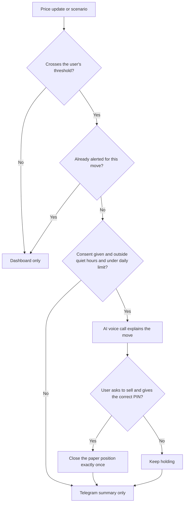

# 📞 Stock Calling: an AI portfolio assistant that calls you when it matters

**PromptWars × TechVerse Solutions · Track: Finance and Student Life**

[](.github/workflows/ci.yml)


🔗 **Live demo (Cloud Run):** https://stock-calling-998510529520.asia-south1.run.app

**Built by:** Tanish Aggarwal, VIPS-TC

---

## 1. Chosen vertical

**Finance and Student Life.**

Students and first-time investors often buy a few shares and then stop watching them. Nobody keeps a market dashboard open all day, so a 6% crash or a sudden spike usually goes unnoticed until it's too late to act.

**Stock Calling** is a smart, dynamic assistant that watches a paper portfolio for you and **phones you only when a move actually matters to you**. You hear what happened and why, can ask follow-up questions in English, Hindi or Hinglish, and get a written summary on Telegram afterwards.

## 2. Approach and logic

The assistant makes decisions from the **user's own context**, not from fixed global rules.

| User context | Decision the assistant makes |
|---|---|
| Holdings, average buy price and per-stock crash / gain thresholds | Whether a price move is big enough to alert on |
| Call consent, Telegram consent, quiet hours, daily call limit | Whether to call now, send Telegram only, or stay silent |
| Alerts already sent for this holding and direction | Never alert twice for the same move (idempotent alerts) |
| Company-impact events (governance, labour, regulatory, sustainability) and their review status | What context to explain on the call; unreviewed headlines never trigger a call |
| The live call transcript plus a demo PIN | Whether a spoken "sell" request is authorised to close the paper position |

### Decision flow



## 3. How the solution works

1. **Dashboard (React + TypeScript + Tailwind):** live quotes for 12 Indian companies plus NIFTY 50, SENSEX and BANK NIFTY, market movers, holdings and a paper portfolio in a Groww-inspired dark UI.
2. **API (Express 5 on Node.js 24):** stores settings, holdings, orders, alerts, calls and messages in PostgreSQL (PGlite when no database URL is set).
3. **Policy engine (`server/policy.ts`):** checks consent, India quiet hours, the daily call limit and the minimum gap between calls before anything is sent.
4. **Voice (OmniDimension):** places a real two-way AI phone call with the alert context. Results are synced from the provider's call logs every 20 seconds.
5. **Paper sale (`server/paper-sell.ts`):** a sale only runs after the backend validates the transcript and the demo PIN, and it can't run twice.
6. **Telegram outbox:** a persistent, deduplicated outbox sends summaries with backoff on rate limits. A send with an unknown result is never blindly retried.

### Key files

```text
server/
  index.ts         API, security middleware and server start-up
  policy.ts        Consent, quiet hours and call limits
  portfolio.ts     Paper purchases, thresholds and scenarios
  paper-sell.ts    Transcript + PIN sale authorisation
  integrations.ts  Voice calls, transcript sync, Telegram outbox
  monitor.ts       Research discovery and alert routing
  market.ts        Market quotes and caching
  db.ts            Schema and persistence
src/main.tsx       Dashboard UI
tests/             Automated tests
Dockerfile         Container image used by Cloud Run
```

## 4. Security

- **Helmet** security headers, **rate limiting** on every API route (and a stricter limit on calls).
- **Zod validation** on every request body, plus a 32 kB JSON size limit and JSON-only writes.
- **Origin allow-list** for browser requests.
- **Private mode:** with `CLOUD_MODE=true`, the dashboard needs a login (`DASHBOARD_PASSWORD`, at least 20 characters), compared with a timing-safe check.
- **Public demo mode:** with `PUBLIC_DEMO=true` (used for the judging link), anyone can view and try the paper portfolio, but saving API keys, placing calls and Telegram/voice actions are blocked with `403`.
- API keys are redacted from error messages. **No secrets in the repository:** only `.env.example` with empty values.
- The container runs as the non-root `node` user.

## 5. Testing

```bash
npm ci
npm test        # automated tests (Node test runner)
npm run build   # type-check + production build
```

The tests cover:

- quiet-hour boundaries and consent / verification gates;
- provider dispatch, transcript summaries and Telegram de-duplication using mocked providers;
- secure Telegram chat registration, rate-limit backoff and uncertain-send handling;
- idempotent paper purchases, threshold boundaries and separate crash / gain alerts;
- PIN-authorised sales: correct PIN, wrong PIN, cancellation, stale holdings and exactly-once execution.

GitHub Actions runs the tests and the production build on every push (`.github/workflows/ci.yml`).

## 6. Accessibility and usability

- Dark, high-contrast theme with alt text on images and responsive layouts for mobile and desktop.
- Clear labels for quote delays, demo prices and call status, so users always know what is real and what is simulated.
- Voice alerts mean users don't have to stare at a screen, and the AI understands English, Hindi and Hinglish.

## 7. Run it yourself

```bash
git clone https://github.com/TanishAggarwall/stock-calling-promptwars.git
cd stock-calling-promptwars
npm ci
cp .env.example .env.local   # add your own keys (optional for the dashboard)
npm run build
npm start                    # http://localhost:3000
```

### Deploy to Google Cloud Run

```bash
gcloud run deploy stock-calling --source . --region asia-south1 \
  --allow-unauthenticated --memory 1Gi --port 3000 \
  --set-env-vars PUBLIC_DEMO=true
```

## 8. Assumptions

- Market quotes come from a real provider and may be delayed; the UI labels that.
- **All trades are paper (simulated).** No real money moves and there is no brokerage integration.
- Crash / gain scenarios are triggered manually for the demo; they never change the real quote.
- Voice calls and Telegram messages need the user's own OmniDimension and Telegram keys plus explicit consent. Without them, the dashboard and paper portfolio still work.
- Single-user app: one person's settings, holdings and phone number per deployment.
- The public Cloud Run demo uses temporary storage, so demo data may reset when the service restarts.

---

The design is Groww-inspired with original application flows. This is an independent student project, not an official Groww product. Company logos and fonts belong to their owners; see [asset credits](docs/ASSETS.md).
